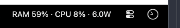
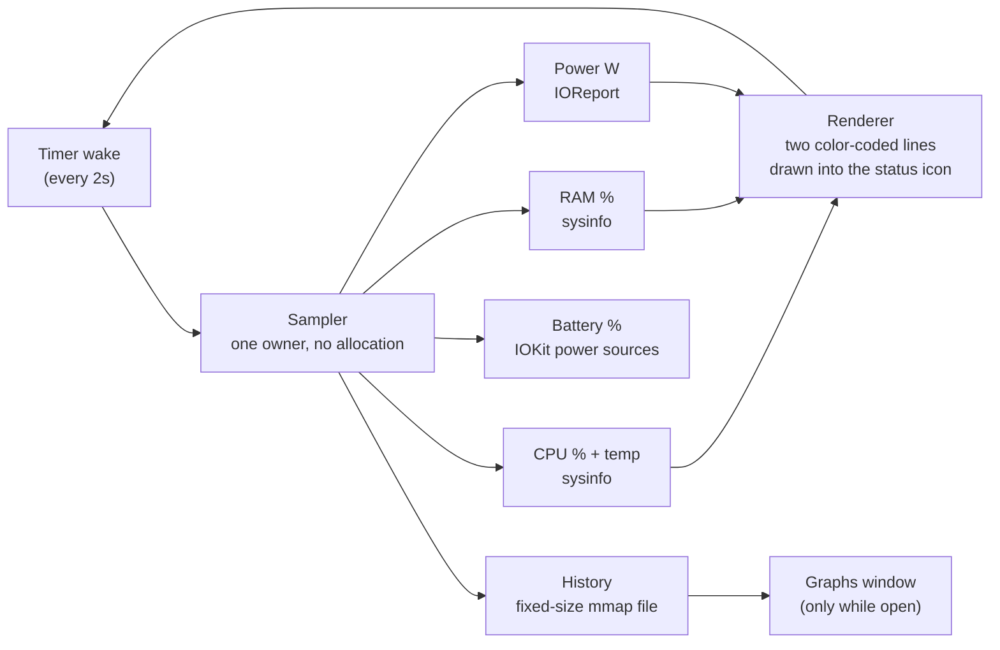

[](https://crates.io/crates/featherbar)
[](https://crates.io/crates/featherbar)
[](LICENSE)

____
<br>

<div align="center">

# featherbar

**A featherweight macOS menu-bar system monitor that stays featherweight.**

</div>

A tiny, modular menu-bar (NSStatusItem) app in Rust that shows live stats on two compact, color-coded lines:

<div align="center">



</div>

Updates every 2 seconds. Right-click for **Show Graphs**, launch-at-login and Quit.

> **The premise.** Most menu-bar monitors slowly become what they measure: background threads, growing buffers, tens of MB of RSS. featherbar runs **zero background threads** and allocates **nothing that accumulates** — one main-thread event loop wakes on a timer, takes one sample, redraws the display, and re-arms. Even its history is a fixed-size file that never grows. Memory stays flat for as long as it runs.

## Features

- **Live stats on two stacked lines**: CPU % + SoC package watts on top, RAM % + CPU temperature below, refreshed every 2s
- **Color-coded severity**: each value renders green / orange / red by its own thresholds (CPU 40/70%, RAM 75/85%, power 10/20W, temp 60/80°C); labels stay neutral
- **Perfectly gridded**: SF Mono with fixed-width value fields — nothing shifts when a value changes digit count
- **Graphs window**: right-click → **Show Graphs** for CPU, power, memory, temperature and battery % over the last minute, 5 min, 30 min, hour or day (see [Graphs](#graphs))
- **History that survives restarts**: one fixed-size, memory-mapped file — never grows, no background writer
- **Menu-bar only until you ask**: `ActivationPolicy::Accessory` — no Dock icon; while the graphs window is open it gets a Dock icon and Cmd-Tab entry, which go away when you close it
- **No background threads**: a single main-thread `tao` event loop with `ControlFlow::WaitUntil` timer wakes — even sysinfo's rayon pool is compiled out
- **Launch at login toggle**: right-click menu check item backed by `SMAppService` (when running as the `.app` bundle)
- **Flat memory by design**: one `Sampler` owns all sampling state, one `Renderer` owns all drawing state; every tick's ObjC temporaries die in an explicit autorelease pool
- **Measured footprint**: 11 MB at launch, settling at a flat ~20 MB steady state (`phys_footprint`, the Activity Monitor number) on an M-series MacBook Pro — soak-profiled leak-free with `leaks` (live heap ~6.5 MB; the rest is one-time allocator high-water, and it stops moving). That's the menu bar alone, measured before the graphs window existed; the window adds AppKit drawing memory while it's open (tens of MB) and is torn down when closed
- **Modular metrics**: adding a stat is an enum variant + a few match arms
- **Tiny binary**: ~800 KB release build (`opt-level = "z"`, LTO, stripped)



## Graphs

Right-click the menu-bar reading → **Show Graphs** opens a normal, resizable Mac window with five stacked graphs: CPU, power, memory, temperature and battery.

- **Ranges**: Minute · 5 Minutes · 30 Minutes · Hour · Day. The window remembers its position, size and chosen range.
- **Colour bands** behind each graph use the same green / orange / red thresholds as the menu bar, so "how long has memory been high?" is "how long has the line sat in the orange?". Battery is flipped — red below 10%, orange to 20% — since low is the bad end.
- **Header stats** for the selected range: now, average, and peak (lowest, for battery).
- **Hover** anywhere for the exact time and value across all five graphs.
- **Smoothing on long ranges**: samples are merged into buckets a few pixels wide; the line is the bucket average and a shaded band runs from its low to its high, so short spikes and dips stay visible.
- **Gaps** where featherbar wasn't running or the Mac was asleep show as breaks in the line, not as a straight line joining the ends.

History lives in `~/Library/Application Support/Featherbar/history.bin` — one ~124 KB memory-mapped file holding ~1 hour of 2-second samples plus 24 hours of per-minute average / low / peak. Recording a sample is a plain memory write; the kernel flushes it to disk. The file never grows, and an unreadable or older-format file is simply started fresh.

___

<br>
<details>
  <summary>1. Requirements</summary>

- macOS on Apple Silicon (M-series)
- Rust **1.89+**

</details>

<details>
  <summary>2. Installation</summary>

#### As an .app bundle (recommended — enables the launch-at-login toggle)

```bash
git clone https://github.com/nim444/featherbar.git
cd featherbar

# Build the release binary and assemble Featherbar.app (ad-hoc signed)
./scripts/bundle.sh
cp -R target/Featherbar.app /Applications/
open /Applications/Featherbar.app
```

#### As a bare binary

```bash
# From crates.io
cargo install featherbar
featherbar

# Or from a checkout
cargo run --release
```

The reading appears in your menu bar immediately. There is no Dock icon — right-click the menu-bar text for **Show Graphs**, the login toggle and **Quit**.

#### Launch at login

Right-click the menu-bar reading and check **Launch at login**. The toggle uses Apple's `SMAppService` API, which only works from a real `.app` bundle — from a bare `cargo run` binary the item is shown disabled. Verify the registration anytime in **System Settings → General → Login Items**.

</details>

<details>
  <summary>3. Project Structure</summary>

```
├── src/
│   ├── main.rs          # Metric enum, Sampler, thresholds, event loop, menu
│   ├── two_line.rs      # Renderer: two color-coded lines drawn into the icon
│   ├── history.rs       # Fixed-size memory-mapped history file + downsampling
│   ├── graphs.rs        # The Show Graphs window (one custom NSView)
│   ├── socpower.rs      # SoC package watts via IOReport
│   ├── battery.rs       # Battery % via IOKit power sources
│   └── login_item.rs    # Launch-at-login via SMAppService
├── scripts/
│   ├── bundle.sh        # Assemble Featherbar.app from the release binary
│   └── make_icon.sh     # Regenerate AppIcon.icns from icon.svg
├── assets/
│   ├── icon.svg         # App icon source
│   ├── AppIcon.icns
│   └── menubar.png
├── Cargo.toml           # size-optimized release profile, trimmed features
├── Cargo.lock
├── LICENSE              # Apache-2.0
└── README.md
```

One file per job. The app is small enough that splitting it up further would only add indirection.

</details>

<details>
  <summary>4. How It Works</summary>

The hard macOS constraints this design satisfies:

- The `tao` event loop must run on the **main thread**, and the tray icon must be created on that same thread.
- The tray icon is created **after the loop is running** — on `StartCause::Init`, not before.
- `ActivationPolicy::Accessory` keeps it out of the Dock and the app switcher (the graphs window switches to `Regular` while open, and back on close).

The loop itself:

1. `StartCause::Init` — create the tray icon, locate its `NSStatusBarButton`, draw the first reading, arm a 2s `ControlFlow::WaitUntil` timer.
2. `StartCause::ResumeTimeReached` — take one sample of every metric, write it into the history file, redraw the menu bar (and the graphs, if open), re-arm.
3. Menu clicks arrive as user events through a tao `EventLoopProxy`, so they're handled immediately rather than on the next tick.
4. Nothing else. No threads, no channels to background workers, no growing buffers.

**Why the display is an image:** NSStatusItem text titles are vertically centered by the button cell with no working override, and a single-line title can't stack two rows. So the `Renderer` draws both lines into an `NSImage` each tick — glyph positions computed from real font metrics (cap height, descent), colors per severity, Retina-sharp. The button can't fight pixels.

**Why memory stays flat:** one `Sampler` owns the `sysinfo::System` (created empty — no process table), the component list, and the IOReport subscription; history is a fixed-size `mmap`ed file allocated once; one `Renderer` owns the font and four prebuilt attribute dictionaries. Per tick only the strings and the image are created, and an explicit `autoreleasepool` kills them before the loop sleeps again. The footprint rises from 11 MB at launch to ~20 MB as the malloc zones reach their high-water mark, then stops: a profiled soak shows ~6.5 MB live heap, no featherbar leaks, and a flat line from there.

Measure it yourself while it runs (same metric Activity Monitor shows):

```bash
footprint $(pgrep -x featherbar)
# featherbar [pid]: 64-bit    Footprint: 11 MB   (launch; settles at ~20 MB and stays flat)
```

</details>

<details>
  <summary>5. Adding a Metric</summary>

1. Add a variant to `Metric` in `src/main.rs` with the next slot number (the number is its position in the history file, so never reorder) and add it to `Metric::ALL`.
2. Give it thresholds in `Metric::thresholds` (and `low_is_bad` if lower is worse), read it in `Sampler::read`, and format it in `fragment`.
3. Bump `METRICS` and `VERSION` in `src/history.rs` — the file layout changed, so old history is started fresh.
4. Add its label, format and scale in `src/graphs.rs`; the compiler points at every match that needs an arm.
5. To show it in the menu bar too, put it on a line:

```rust
const LINE_BOTTOM: &[Metric] = &[Metric::Ram, Metric::Temp, Metric::DiskFree];
```

Good candidates with maintained crates and no reverse engineering: network up/down (`sysinfo` networks), disk free (`sysinfo` disks).

**Checking the graphs without clicking around:** debug builds can seed a fake day of history and render the window to PNGs, then exit:

```bash
cargo build
FEATHERBAR_HISTORY=/tmp/demo.bin FEATHERBAR_SEED=1 FEATHERBAR_SNAPSHOT=/tmp/snap ./target/debug/featherbar
```

</details>

<details>
  <summary>6. Behavior Notes (not bugs)</summary>

- **Power is SoC package power** (CPU + GPU + ANE) from IOReport's "Energy Model" channels — what `powermetrics` calls "Combined Power". It reads the same on battery or AC.
- **`—W` is shown** on the first tick (the reading is a delta of two samples) or if IOReport is unavailable; **`—°C`** when no die sensor is found.
- **The Battery graph says "No data"** on Macs without a battery.
- **History starts when featherbar first runs** — the Day view fills in over 24 hours. Upgrading to a version that stores a different set of metrics starts the history fresh.
- **Temperature is the hottest CPU die sensor** (`PMU tdie*`), which is what "CPU temp" colloquially means — individual sensors run cooler.
- **The first CPU sample may be off** for one tick until the second refresh lands.

</details>

<details>
  <summary>7. Scope — what featherbar will not do</summary>

Fans are **out of scope**. They require undocumented SMC keys that break with each new Apple Silicon generation — the exact maintenance treadmill this project exists to avoid. (CPU temperature *is* shown, through `sysinfo`'s maintained Components API, and SoC power through IOReport, whose interface has been stable across M1 → M4.) If you need fans, [Stats](https://github.com/exelban/stats) does them well and pays that maintenance cost for you.

</details>

<details>
  <summary>8. Tech Stack</summary>

| Layer | Crate |
|---|---|
| Menu-bar icon (NSStatusItem) | `tray-icon` 0.21 |
| Main-thread event loop | `tao` 0.34 |
| RAM / CPU / temperature sampling | `sysinfo` 0.33 |
| SoC power, battery % | IOReport + IOKit via `core-foundation` 0.10 |
| Graphs window | `objc2-app-kit` 0.3 (AppKit) |
| History file | `libc` (`mmap`) |

Release profile: `opt-level = "z"`, `lto = true`, `strip = true` → ~800 KB binary.

</details>

## Roadmap

- Network up/down and disk-free metrics
- A settings menu to toggle which metrics are shown at runtime

____
<br>

[](LICENSE)
